  

  <a href="#start-here"><b>Projects</b></a> &nbsp; / &nbsp;
  <a href="#on-the-workbench-friday"><b>Workbench</b></a> &nbsp; / &nbsp;
  <a href="#toolbox"><b>Toolbox</b></a>

 

I'm **Cebin**. I build assistants you can talk to, agents that drive the desktop, and software that keeps working when the internet doesn't.

Most of it starts as a late-night experiment on a CachyOS box and ends up as something people actually use, from a Turkish voice HUD to a design tool that furniture makers use on site.

## Start here

<table>
  <tr>
    <td width="33%" valign="top">
      01 / VOICE
      <h3>F.R.I.D.A.Y.</h3>
      
A Turkish voice assistant with a living HUD: an ember particle figure, Gemini Live voice, agent tools, phone integration and real system telemetry.

      
<code>Next.js</code> <code>React</code> <code>three.js</code> &nbsp;·&nbsp; private, in active development

    </td>
    <td width="33%" valign="top">
      02 / DESKTOP
      <h3>Vox</h3>
      
Voice control for Windows 11 that never talks back. A small glass capsule slides down from the top of the screen, and a desk-robot face answers with chirps, moods and sound effects. Runs fully local.

      
<code>Python</code> <code>faster-whisper</code> &nbsp;·&nbsp; private, in development

    </td>
    <td width="33%" valign="top">
      03 / FURNITURE
      <h3>Dolapist</h3>
      
Sketch a cabinet by hand and get a 3D model, a cut list and a quote back. Built for furniture makers, on the phone, the web and the desktop.

      
<code>TypeScript</code> <code>three.js</code> <code>Capacitor</code> &nbsp;·&nbsp; private, in development

    </td>
  </tr>
</table>

## On the workbench: F.R.I.D.A.Y.

  

The goal is an assistant that feels present: it listens, answers in Turkish, sees what the machine is doing, and can act on it. Everything else I build tends to borrow parts from it.

## Also in the lab

| Project | What it does |
| :--- | :--- |
| **JARVIS v2** | A local-first AI operating layer for Linux. One brain, many models, many tools, many workers. |
| **Atlas** | A computer-use agent in Electron. The model sees the screen and operates the desktop. |
| **Password Manager** | Cross-platform, zero-knowledge vault. AES-256-GCM core shared by desktop and browser extension. |
| **AI Business Assistant** | Multi-tenant SaaS that answers WhatsApp and Instagram DMs for local businesses, with one-click human takeover. |
| **Game Subtitle Translator** | Captures in-game subtitles with OCR and overlays a live translation. |

## Toolbox

  

## Recent signal

  <picture>
    <source media="(prefers-color-scheme: dark)" srcset="https://raw.githubusercontent.com/ccebin/ccebin/output/github-snake-dark.svg">
    <source media="(prefers-color-scheme: light)" srcset="https://raw.githubusercontent.com/ccebin/ccebin/output/github-snake.svg">
    
  </picture>

 

  

